<div align="center">

# AI4SE Atlas

**An open research directory for AI for Software Engineering**

Researchers · Topics · Papers · Open-source projects

Open source · No rankings · Alphabetical · Every researcher, paper and project cites a public source

<a href="https://xiaobo-coder.github.io/AI4SE-Atlas/"></a>

[**Website**](https://xiaobo-coder.github.io/AI4SE-Atlas/) · [Explore](https://xiaobo-coder.github.io/AI4SE-Atlas/explore/) · [Researchers](https://xiaobo-coder.github.io/AI4SE-Atlas/researchers/) · [Topics](https://xiaobo-coder.github.io/AI4SE-Atlas/topics/) · [Papers](https://xiaobo-coder.github.io/AI4SE-Atlas/papers/) · [Projects](https://xiaobo-coder.github.io/AI4SE-Atlas/projects/) · [Contribute](CONTRIBUTING.md)

</div>

---

## Why another list?

Most "awesome" lists are flat collections of links. AI4SE Atlas keeps a small **data model** instead. Researchers, papers, topics and projects are separate records that reference each other, so you can start from a topic and follow it to the people, papers and tools behind it. The website is only one view of the data. You can reuse the same data as YAML, JSON or BibTeX.

| | |
|---|---|
| **For people** | Browse researchers A–Z, explore ten research topics, find papers and the code that implements them. |
| **For machines** | YAML source files, JSON Schema contracts, JSON / CSV / BibTeX exports, a page per paper with Google Scholar `citation_*` tags and schema.org `ScholarlyArticle`, a sitemap and `llms.txt`. |
| **Fair by design** | No rankings, no citation counts, no popularity order. Corrections and removal on request. |

## Use the data

```sh
# everything in one file
curl -s https://xiaobo-coder.github.io/AI4SE-Atlas/data/atlas.json | jq '.papers[] | select(.topics[] == "ai-agents") | .title'

# all papers as BibTeX
curl -s https://xiaobo-coder.github.io/AI4SE-Atlas/data/papers.bib > ai4se-atlas.bib
```

```python
import yaml  # or read data/*.yaml straight from a clone
papers = yaml.safe_load(open("data/papers.yaml"))
agents = [p["title"] for p in papers if "ai-agents" in p["topics"]]
```

Endpoints: `data/atlas.json`, `data/researchers.json`, `data/topics.json`, `data/papers.json`, `data/projects.json`, `data/papers.csv`, `data/papers.bib`, `sitemap.xml`, `llms.txt`.

## Research topics (v1)

| ID | Topic |
|---|---|
| `ai-code-generation` | AI for Code Generation |
| `ai-software-testing` | AI for Software Testing |
| `ai-program-analysis` | AI for Program Analysis |
| `ai-software-security` | AI for Software Security |
| `ai-software-maintenance` | AI for Software Maintenance |
| `ai-devops` | AI for DevOps and CI/CD |
| `ai-requirements` | AI for Requirements Engineering |
| `ai-software-architecture` | AI for Software Architecture |
| `ai-agents` | AI Agents for Software Engineering |
| `ai-empirical-se` | Empirical Studies of AI in Software Engineering |

The taxonomy is versioned. Propose changes with the **Propose a taxonomy change** issue template.

## Contribute

Add a paper in one line (metadata comes from the arXiv API): `python scripts/add_arxiv.py 2611.03523 --topics ai-agents`.


Suggest a researcher, paper or project with an [issue template](../../issues/new/choose), or open a pull request that edits `data/*.yaml`. Every record needs a public source. See [CONTRIBUTING.md](CONTRIBUTING.md) and [GOVERNANCE.md](GOVERNANCE.md).

> AI4SE Atlas is independently maintained and updated every Saturday. Community contributions are welcome and reviewed as part of the weekly maintenance cycle. Updates are provided on a best-effort basis.

If the atlas is useful to you, a ⭐ helps other people find it.

## Cite

Use GitHub's **Cite this repository** button (from [`CITATION.cff`](CITATION.cff)). A Zenodo DOI will be added with the first archived release.

## Repository layout

```
data/        YAML records: researchers, topics, papers, projects
schemas/     JSON Schemas for each record type
scripts/     validate.py (schemas, references, duplicates), add_arxiv.py, make_map_svg.py, tests
website/     Astro + Tailwind static site (reads data/ at build time)
assets/      animated topic map (SVG for the README, GIF for slides/posts), social preview image
.github/     issue and PR templates, validate and deploy workflows
```

## Run locally

```sh
python -m venv .venv && . .venv/bin/activate
pip install -r scripts/requirements.txt
python scripts/validate.py

cd website
npm ci
npm run dev          # http://localhost:4321/AI4SE-Atlas/
npm run build        # static site in website/dist/
```

## Deploy (GitHub Pages)

1. Create a public repository named `AI4SE-Atlas` and push this folder to `main`. (An empty repository has no Pages source option yet.) The first `deploy` run fails because Pages is not enabled; that is expected.
2. **Settings → Pages → Build and deployment → Source: GitHub Actions.**
3. **Actions → deploy → Run workflow.** After that, every push to `main` redeploys automatically. The workflow sets the site URL and base path; local builds can override them with `ATLAS_BASE` and `ATLAS_SITE`.
4. Create the issue labels used by the templates: `new-record`, `researcher`, `paper`, `project`, `correction`, `taxonomy`. Enable **Settings → Security → Private vulnerability reporting**.
5. Optional: **Settings → General → Social preview** → upload `assets/social-preview.png`.

## License

Code: [MIT](LICENSE). Data: facts come from the cited public sources; the project's own contributions (taxonomy, descriptions, selection) are CC BY 4.0. See [DATA_LICENSE.md](DATA_LICENSE.md).

The atlas is not affiliated with, and does not speak for, any listed person, institution or company.
